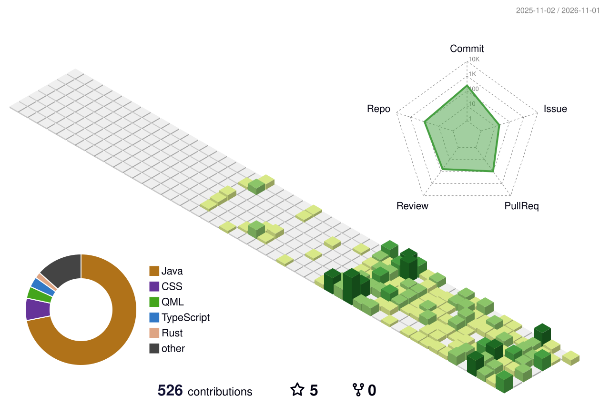

<!-- CRT card: regenerate with `python3 .github/scripts/make-profile-card.py` -->

  

<h2 align="center">😊 Hi, I'm Yong Wan</h2>

<em>Coding for fun — mostly around the Apache ShenYu API gateway.</em>

<samp>
  <a href="https://github.com/wy471x">github</a> .
  <a href="mailto:wanyong@apache.org">mail</a> .
  <a href="#-activity">activity</a>
</samp>

  
  &nbsp;
  

## 🎡 Activity

	<picture>
	  <source media="(prefers-color-scheme: dark)"  srcset="https://raw.githubusercontent.com/wy471x/wy471x/output-3d-contrib/night.svg" />
	  <source media="(prefers-color-scheme: light)" srcset="https://raw.githubusercontent.com/wy471x/wy471x/output-3d-contrib/day.svg" />
	  
	</picture>

	<picture>
	  <source media="(prefers-color-scheme: dark)"  srcset="https://raw.githubusercontent.com/wy471x/wy471x/output-snake/github-snake-dark.svg" />
	  <source media="(prefers-color-scheme: light)" srcset="https://raw.githubusercontent.com/wy471x/wy471x/output-snake/github-snake.svg" />
	  
	</picture>

